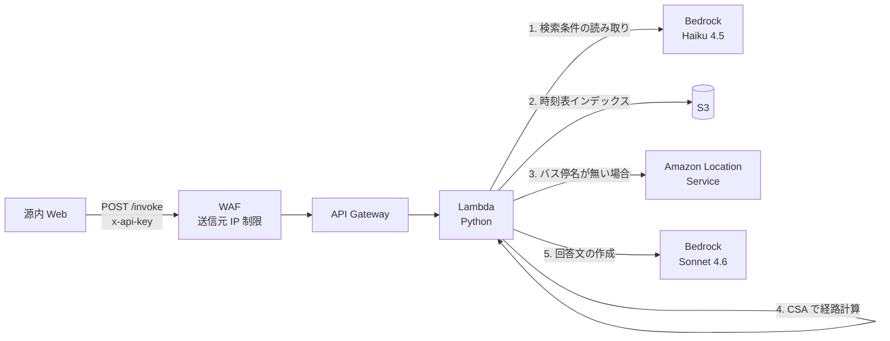

# genai-ai-bus-sample（バス経路検索 AI アプリ）

[源内 Web](https://github.com/digital-go-jp/genai-web) に登録する ExApp（行政実務用 AI アプリ）のサンプルです。
自然言語の問い合わせから、バスの経路と乗り換えを案内します。
宮崎県都農町のコミュニティバス（GTFS-JP）で動作を確認しています。

ExApp の API 仕様は、源内 Web の [AI アプリ API 仕様](https://github.com/digital-go-jp/genai-web/blob/main/docs/AIアプリAPI仕様.md) に従っています。

## 処理の流れ



1. 利用者が自然言語で経路を検索する
2. Bedrock で検索条件（出発地・到着地・日付・時刻・出発/到着指定）を読み取る（推論 1 回目）
3. S3 の時刻表インデックスを読み込む（Lambda コンテナごとに 1 回）
4. 出発地・到着地がバス停名と一致しなければ、Amazon Location Service で座標を求め、周辺 800 m のバス停を候補にする
5. CSA（Connection Scan Algorithm）で乗り換え順を計算する（出発指定は次の便まで最大 3 件、到着指定は間に合う最も遅い便から 2 件）
6. 計算結果をもとに、分かりやすい回答文を作る（推論 2 回目）。18 秒を過ぎていたら、推論を省いて決まった書式で返す

源内 Web の同期呼び出しは 29 秒で打ち切られるため、Lambda のタイムアウトは 28 秒です。

## 構成

| パス | 内容 |
|---|---|
| `lambda/bus_route/handler.py` | Lambda 本体（API の入出力、処理の流れ） |
| `lambda/bus_route/csa.py` | CSA による経路探索 |
| `lambda/bus_route/timetable.py` | 時刻表インデックスの読み込み、運行日判定、バス停検索 |
| `lambda/bus_route/llm.py` | Bedrock 呼び出し（推論 2 回） |
| `lambda/bus_route/geo.py` | Amazon Location Service（Places API v2）のジオコーディング |
| `tools/build_index.py` | GTFS(-JP) zip から時刻表インデックスを作るツール |
| `lib/bus-route-stack.ts` | CDK スタック（S3、Lambda、API Gateway、API キー、WAF） |
| `parameter.ts` | 環境ごとの設定 |
| `tests/` | CSA とインデックス作成のテスト |

## セットアップ

### 1. 設定

`parameter.ts` の `dev` を対象地域に合わせて設定します。

- `regionName`: 地域名（回答文に使う）
- `biasPosition`: 地域の中心の `[経度, 緯度]`（ジオコーディングの精度が上がる）
- `parseModelId` / `answerModelId`: Bedrock のモデル（推論 1 回目 / 2 回目）
- `allowedIpV4AddressRanges`: 源内 Web の送信元 IP（例の値が入っています）

源内 Web の送信元 IP は、源内 Web の [AI アプリ登録手順書](https://github.com/digital-go-jp/genai-web/blob/main/docs/AIアプリ登録手順書.md) の手順 1 で確認できます（TeamAccessControl スタックの NAT ゲートウェイの EIP 2 つ）。
公開したくない値は、git 管理外の `parameter.local.ts` に書くと `parameter.ts` より優先されます。

```ts
// parameter.local.ts
import type { BusRouteParams } from './parameter';

export const localParams: Record<string, Partial<BusRouteParams>> = {
  dev: {
    allowedIpV4AddressRanges: ['<NAT EIP 1>/32', '<NAT EIP 2>/32'],
  },
};
```

### 2. デプロイ

```bash
npm install
```

```bash
npx cdk deploy -c env=dev
```

### 3. 時刻表データの投入

公共交通オープンデータセンターから対象地域の GTFS(-JP) zip をダウンロードし、インデックスにして S3 に置きます。
時刻表データはこのリポジトリには含めていません（`data/` は git 管理外）。データの利用条件は提供元に従ってください。

```bash
python3 tools/build_index.py data/gtfs.zip data/index.json.gz --name "〇〇市"
```

アップロード先はデプロイ出力の `UploadIndexCommand` に表示されます。

```bash
aws s3 cp data/index.json.gz s3://<DataBucketName>/timetable/index.json.gz
```

データを差し替えたら、Lambda のコンテナが入れ替わるまで古いデータが使われます。すぐ反映するには Lambda の設定を更新（再デプロイなど）してください。

### 4. 源内 Web への登録

1. API キーを取得する（デプロイ出力の `ApiKeyValueCommand` を実行）
2. 源内 Web の `exAppInvokableHostnames` に、デプロイ出力の `ApiHostname` を完全一致で追加して再デプロイする
3. 源内 Web の チーム管理 → チーム → アプリの作成 で、次を登録する
   - エンドポイント: デプロイ出力の `InvokeUrl`
   - API キー: 手順 1 の値
   - リクエスト形式:

```json
{
  "question": {
    "type": "textarea",
    "title": "経路の検索",
    "desc": "例: 明日の朝9時までに〇〇駅から市役所に行きたい",
    "required": true,
    "max_length": 500
  },
  "conversation_history": {
    "type": "textarea",
    "title": "会話履歴"
  }
}
```

## テスト

```bash
npm run test:py
```

## 制限事項（現時点）

- 対象は 1 地域（1 つの GTFS データ）
- 深夜 0 時以降の検索で、前日ダイヤの 24 時過ぎの便は対象外
- 運行情報（遅延・運休）のリアルタイム反映はなし
